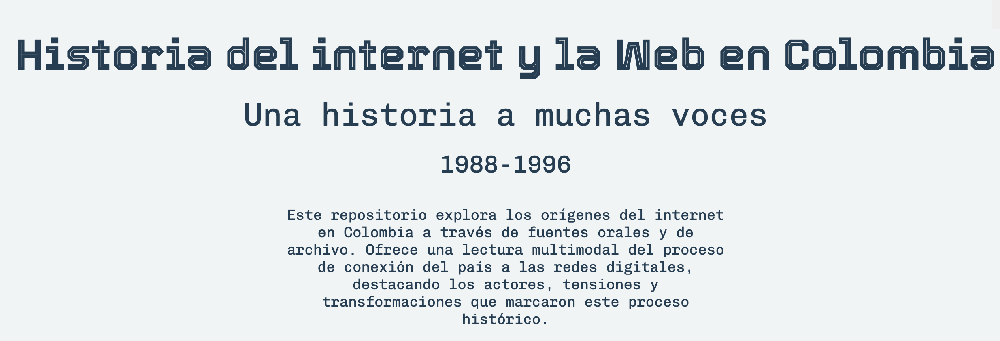

 "
collection: portfolio

Este proyecto se basa en la historia oral para reconstruir los orígenes de Internet y la Web en Colombia. A través de entrevistas a quince personas que participaron directamente en los primeros procesos de conectividad digital, recogimos relatos en primera persona que permiten comprender cómo se vivió la llegada de estas tecnologías y cómo se recuerdan hoy, más allá de los datos técnicos o los registros oficiales.

Cada entrevista fue cuidadosamente preparada y realizada siguiendo un guion flexible, que combinó preguntas personales, institucionales y tecnológicas. Este enfoque permitió que los participantes compartieran libremente sus experiencias, reflexiones y recuerdos sobre los desafíos, aprendizajes e impactos culturales y educativos de Internet en sus etapas iniciales.

Las entrevistas fueron grabadas, transcritas y editadas para facilitar su lectura, manteniendo el sentido original de los testimonios. Posteriormente, el material se organizó mediante un sistema de temas que abarca aspectos tecnológicos, institucionales y sociales, lo que permitió construir una narrativa diversa y accesible sobre los comienzos de Internet en Colombia, desde la voz de quienes fueron parte de esa historia.

De manera complementaria, realizamos un trabajo de investigación en archivos, centrado principalmente en el Archivo Institucional de la Universidad de los Andes, que conserva una parte fundamental de la documentación de este período (1988–1996). Esta sección presenta una curaduría de documentos producidos por distintas entidades involucradas en el proceso, así como algunas fuentes sobre la historia de la computación y las redes en Colombia. Los materiales fueron organizados siguiendo las mismas categorías usadas en las entrevistas, lo que permite articular los testimonios orales con documentos de la época y enriquecer la reconstrucción histórica.

_Créditos_

Investigadores

Jaime Borja, Profesor Titular del Departamento de Historia, Universidad de los Andes (jborja@uniandes.edu.co)
Maria José Afanador Llach, Profesora Asociada, Facultad de Artes y Humanidades, Universidad de los Andes (mj.afanador28@uniandes.edu.co)

Co-investigadora y asistente doctoral
Laura Manrique †, Doctora en Historia, Universidad de los Andes

Monitores de investigación
Raquel Cristancho, estudiante de pregrado en Historia
Julián Duque, estudiante de pregrado en Historia y Narrativas digitales
Rodrigo Borja, estudiante de pregrado en Historia
Ricardo Andrés Flórez, Asistente graduado de la maestría en Humanidades Digitales

